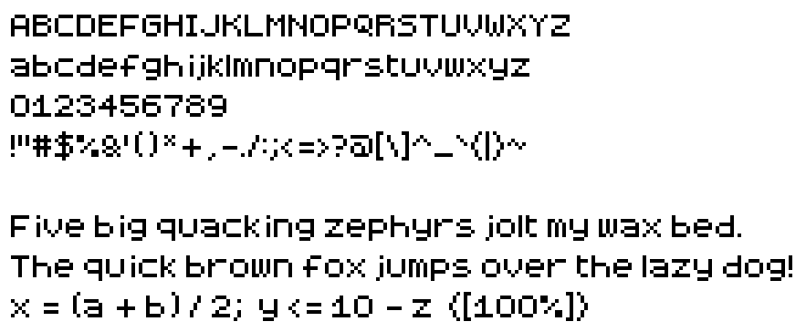

# 8-bit Fortress (modded)

A modified version of the **8-bit Fortress** pixel font by Fortress Tech, made to add glyphs the original lacks (starting with the minus sign `-`).



## Original

- Font: 8-bit Fortress, Version 1.0, built with FontStruct
- Author: Fortress Tech
- Downloaded from: https://www.dafont.com/8-bit-fortress.font
- The font's and license's FontStruct links (fontstruct.com/fontstructors/1477143 and fontstruct.com/fontstructions/show/2517655) no longer work
- License: SIL Open Font License 1.1, no Reserved Font Name declared

The unmodified files are kept in [`original/`](original/):

- `8-bit-fortress.ttf`: the original font, SHA-256 `194d97b6af0c62ba216f2087e6f9bfb53641d7ba5ab2aec2804e7a482a446d1e`
- `8-bit-fortress license.txt`: the license file that came with it

The original has only letters, digits and `` !"#$%&'()*+,.?@_``. Missing ASCII includes `` - / : ; < = > [ \ ] ^ ` { | } ~``.

## Repository

- `original/`: the unmodified font and its license
- `src/8-bit-fortress.png`: the glyph sheet, the only file to edit
- `src/layout.txt`: which character each cell of the sheet holds
- `reference/8-bit-fortress-original.png`: the original font drawn as a glyph sheet, to compare against
- `build/8-bit-fortress-modded.ttf`: the built font
- `build/preview.png`: the preview above
- `tools/`: the Python scripts below

## Editing the font

Edit `src/8-bit-fortress.png` in any pixel editor, then build. The sheet is a grid of cells, 16 per row, and a cell's position decides its character; look it up in `src/layout.txt`.

Each cell is 12 pixels wide and 9 tall: 7 rows above the baseline, 1 below it (tinted blue) and a gray marker row at the bottom. Colors must be exact:

| Color | RGB | Meaning |
|---|---|---|
| Black | 0, 0, 0 | Glyph pixel |
| Magenta | 255, 0, 255 | In the marker row: the advance width, where the next character starts |
| Cyan | 0, 255, 255 | Anywhere in the cell: the character isn't in the font |
| White, gray, blue tint | | Background and guides, ignored |

Any other color, or a cell with neither cyan nor exactly one magenta marker, fails the build with a message naming the cell. To add a character, remove the cyan pixel from its cell, draw it and place the magenta marker. The cell of DEL (0x7F) holds `.notdef`, the glyph shown for characters the font doesn't have.

## Building

Needs Python 3 and the packages in `requirements.txt`:

```bash
pip install -r requirements.txt
```

```bash
python tools/build.py
```

```bash
python tools/verify.py
```

```bash
python tools/preview.py
```

`build.py` traces each glyph's pixels into outlines and writes `build/8-bit-fortress-modded.ttf`; font names and metrics are set at its top. The build is reproducible, so an unchanged sheet gives a byte-identical font. `verify.py` checks every glyph of the built font has exactly the sheet's pixels and width, then lists the characters that differ from the original font. `preview.py` renders `build/preview.png` from the built font, 4 screen pixels per font pixel.

`tools/extract.py` draws the original font into `reference/8-bit-fortress-original.png`; that's also how the edited sheet started, so copying it over `src/8-bit-fortress.png` starts over. `tools/write_reference.py` writes `src/layout.txt`.

## Changes from the original

Added `` - / : ; < = > [ \ ] ^ ` { | } ~``, so all printable ASCII is covered, and redrew `%`, `&`, `+`, `,`, `<`, `>` and `@`.

Converting to whole pixels changed:

- `©` and `®` used half pixels and were removed
- `™` (U+2122) is outside the sheet layout and was dropped
- `.notdef` had hairline borders and diagonals and is now a plain hollow box
- Space's width went from 2.5 to 2 pixels (731 to 585 units)

The font is renamed to "8-bit Fortress Modded" so it can't be mistaken for the original.

## Font metrics

TrueType, 2048 units per em. Glyphs are built from square pixels of 2048 / 7 units, truncated like the original FontStruct export (1 pixel = 292 units, 3 = 877).

## License

This modified font is also licensed under the SIL Open Font License 1.1, see [`LICENSE.md`](LICENSE.md). The original copyright belongs to Fortress Tech. Under the OFL, the font may be used, modified and bundled with software freely, but it may not be sold by itself, and modified versions must stay under the OFL.
